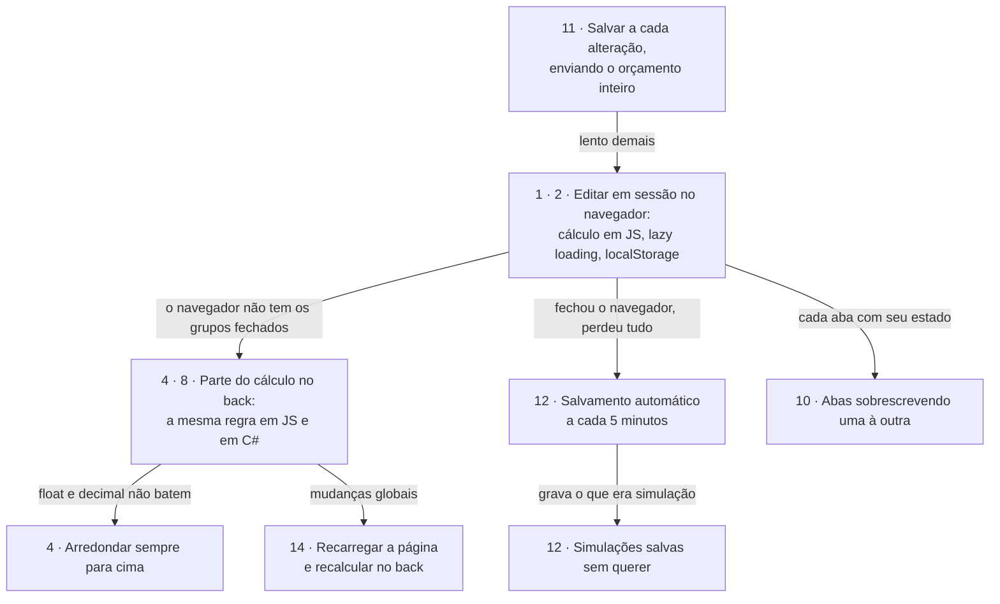
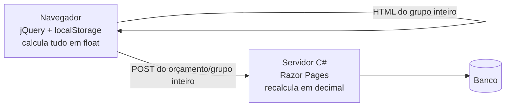
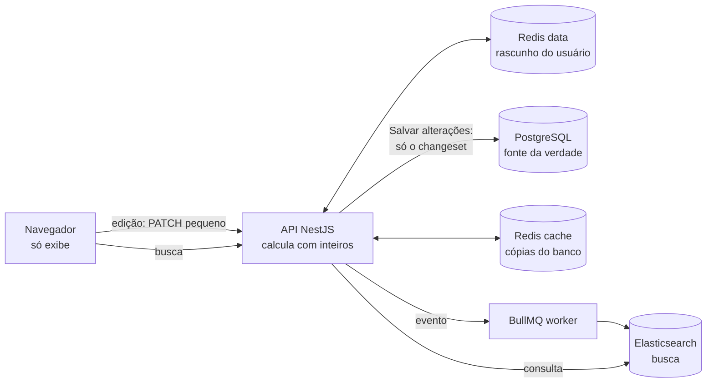

<!--
  ESQUELETO DO README
  - Trechos entre ⟨ ⟩ são para preencher.
  - "—" nas tabelas = número ainda não medido. Preencher só com medições reais (ver "Como medimos").
  - ⟨decidir: …⟩ marca decisões de projeto ainda em aberto.
-->

# Orçamentos v2 · reescrita de um sistema de orçamentos

> Um sistema de orçamentos em que trabalhei tinha problemas de **arquitetura e de lógica**: o *como* tinha sido decidido, não o *quê*. Este repositório reconstrói o problema de forma genérica e mostra **como eu resolveria cada um**, com medições lado a lado.

**Stack:** TypeScript · Node.js · NestJS · PostgreSQL + Prisma · Redis · Elasticsearch · BullMQ · React + Vite · Vitest · Docker · Sentry · Prometheus
**Versão legada (reprodução):** ASP.NET Core Razor Pages · jQuery · PostgreSQL + Entity Framework

[](https://github.com/PhrStyle/rework-budgets-system/actions/workflows/ci.yml)

---

## Sumário

- [Em 30 segundos](#em-30-segundos)
- [Contexto](#contexto)
- [Como o sistema chegou aqui](#como-o-sistema-chegou-aqui)
- [Regras de negócio](#regras-de-negócio)
- [Problemas e soluções](#problemas-e-soluções)
- [Antiga × nova: números](#antiga--nova-números)
- [Arquitetura](#arquitetura)
- [Estudos de caso](#estudos-de-caso)
- [Como medimos](#como-medimos)
- [Stack e por quê](#stack-e-por-quê)
- [Como rodar](#como-rodar)
- [Estrutura do repositório](#estrutura-do-repositório)
- [Como este projeto foi feito](#como-este-projeto-foi-feito)
- [Status](#status)

---

## Em 30 segundos

- **Antes:** um orçamento editado em três lugares (navegador, front em Razor e API), calculado em dois (JavaScript e C#, que não batiam), salvo inteiro, recarregado a cada mudança de margem e aceitável em dev, mas lento na VPS dos EUA.
- **Depois:** a edição vai para um **rascunho no Redis** e só vira oficial em “Salvar alterações”; o servidor calcula com **inteiros**, por **delta**; a busca vai para o **Elasticsearch**; o front só exibe.
- **Resultado:** salvar 1 alteração no pior caso real (1.000 itens), com a rede da VPS emulada: **1,1 s → 170 ms** com 1 usuário e **1,8 s → 169 ms** com 16 ao mesmo tempo, enquanto o Postgres cai de **101% para 8% de CPU**; e a tela mostra o mesmo total que fica salvo.

<!-- GIF curto: abrir orçamento grande na legada vs nova, lado a lado (docs/img/antes-depois.gif) -->
<!--  -->

---

## Contexto

| | |
|---|---|
| **Produto** | Sistema de orçamentos: listagem com filtros; orçamento com cabeçalho (cliente, vendedor, status, ajuste de prazo %, margem %), grupos personalizáveis e produtos com busca, quantidade, desconto por item e ordenação |
| **Escala** | Orçamentos com ⟨milhares⟩ de produtos; orçamentos podem conter outros orçamentos (1 nível) |
| **Stack original** | C# · Razor Pages (front) + API ASP.NET (back), em projetos separados · jQuery · JavaScript · `localStorage` · PostgreSQL + Entity Framework |
| **Infra original** | VPS Contabo, US Central; usuários no Brasil |
| **Meu papel** | Engenheiro de software, único desenvolvedor do sistema |

Assumi o sistema depois de **dois anos** de desenvolvimento por outra pessoa, já **em produção**, com o cliente usando no dia a dia e várias decisões de arquitetura e de lógica que causavam os problemas abaixo. Este repositório é o registro de como eu os corrigiria sem as restrições da época.

> O sistema antigo é reproduzido aqui **de forma genérica**, com dados fictícios. Não é o código original.

---

## Como o sistema chegou aqui

As regras do sistema antigo são confusas, e **essa confusão é o problema**. Ninguém projetaria de propósito um orçamento calculado em parte no navegador e em parte no servidor, salvo inteiro a cada 5 minutos e recarregado a cada mudança de margem. Ele chegou a isso aos poucos: cada decisão fazia sentido para resolver o sintoma da anterior, e criava o próximo.

**Por que paliativos, e não a solução certa?** Porque as condições não permitiam uma refatoração profunda:

- **O sistema estava em produção**, usado pelo cliente todos os dias: qualquer mudança grande precisava acontecer sem parar o trabalho de ninguém.
- **O banco tinha dois anos de registros.** Mudar o modelo (por exemplo, trocar `decimal` por inteiros ou tirar o cálculo do navegador) exigiria migrar e validar dados reais de clientes, com o risco de alterar valores de orçamentos já enviados.
- **O cliente continuava pedindo funcionalidades novas**, ao mesmo tempo em que precisava que as funções problemáticas voltassem a funcionar corretamente.

Com produção, dados históricos e funcionalidades novas disputando o mesmo tempo, o caminho viável era corrigir o sintoma visível dentro do sistema existente. Cada correção pontual adiava a solução adequada e somava mais uma camada à cadeia abaixo.



Os números são os dos [problemas](#problemas-e-soluções). Os demais (3, 5, 6, 7, 9 e 13) não nascem dessa cadeia, mas somavam a ela: busca lenta, totais de orçamentos vinculados defasados, um ambiente de produção muito mais lento que o de desenvolvimento, uma tela difícil de manter, deploys que quebravam o front em cache e um caminho dobrado entre o navegador e a API.

Este repositório faz o que não era possível na época: parte do zero, sem dados históricos a preservar nem funcionalidades novas disputando o prazo, para mostrar a solução adequada de cada problema. A versão nova não corrige um paliativo de cada vez: **ela desfaz a cadeia na origem**. O cálculo fica num lugar só (o servidor, com inteiros), a edição vai para um rascunho no servidor, e salvar grava só o que mudou. Sem a primeira caixa, as outras deixam de ser necessárias.

---

## Regras de negócio

As duas versões implementam as mesmas regras; só muda **como**.

| Regra | Definição |
|---|---|
| Item | `preço por unidade × quantidade × (1 − desconto do item %)` |
| Unidades | Cada produto tem a sua: **un** (só inteiros), **m**, **L** e **kg** (até 2 casas decimais) |
| Desconto | **Só por item**, de 0% a 100%. Não há desconto no grupo nem no total |
| Ajuste de prazo (dilação) | De −100% a +100% (pode ser negativo) |
| Margem | De 0% a +100% (reduções são feitas pelo desconto do item) |
| Grupo | Soma dos itens |
| Orçamento | `(Σ grupos + Σ totais dos filhos) → aplica o ajuste de prazo % → aplica a margem %`, nessa ordem, cada um sobre o resultado anterior |
| Orçamento filho | Um orçamento pode conter outros, **no máximo 1 nível**. O filho entra no pai pelo **próprio total**, já com o prazo e a margem dele; o pai aplica os seus por cima |
| Status | Rascunho, Enviado, Aprovado, Perdido. Apenas organizacional: não muda cálculo nem permissões |
| Edição | As alterações ficam num **rascunho** do usuário e só viram oficiais ao clicar em **“Salvar alterações”**; “Descartar” desfaz tudo. Não há salvamento automático |
| Rascunho | Fica no servidor e sobrevive a navegador fechado ou queda de energia por **30 minutos** desde a última edição. Várias abas do mesmo usuário editam o mesmo rascunho |
| Bloqueio | Enquanto existe o rascunho, o orçamento fica bloqueado para os demais usuários (só visualizam). Bloqueio e rascunho expiram juntos |
| Grupos | Servem para organizar e carregar sob demanda. Vários grupos podem ser abertos, vistos e editados **ao mesmo tempo** |
| Arredondamento | Comercial (meio centavo para cima), só onde há divisão: no item, depois do prazo e depois da margem. Cada linha exibida é um valor real e as linhas somam o total ([ADR 0003](docs/adr/0003-arredondamento-a-cada-passo.md)) |

---

## Problemas e soluções

Agrupados por tema; os números são os mesmos dos estudos de caso e do diagrama acima.

### Cálculo

| # | Problema (antes) | Impacto | Solução (agora) | Resultado |
|---|---|---|---|---|
| 1 | Orçamento inteiro recalculado no navegador a cada alteração (jQuery lendo e escrevendo o DOM) | Tela travando com milhares de itens | Cálculo no servidor, incremental por **delta** | tela × salvo: R$ 0,13 → R$ 0,00 |
| 4 | A mesma regra em JS (float) e em C# (decimal), cada lado calculando uma parte; paliativo: arredondar sempre para cima | Valor na tela ≠ valor gravado; totais enviesados para cima | Dinheiro em **inteiros**, uma só implementação, arredondamento comercial só nas divisões | R$ 988,32 a mais na base de exemplo → R$ 0,00 |
| 8 | Sem testes no front, justamente onde estava parte do cálculo | Erros de valor só apareciam em uso | Cálculo em funções puras de TypeScript, cobertas por testes | 0 → 147 testes + 3 no navegador |
| 14 | Mudar margem, ajuste de prazo (dilação) ou salvar recarregava a página para o back recalcular | Fluxo de trabalho interrompido a cada mudança global | O servidor recalcula a partir dos subtotais; a tela atualiza sem recarregar | mudar margem: 1,1 s → 157 ms, sem recarregar |
| 5 | Orçamento dentro de orçamento (1 nível): o pai guardava uma cópia do total do filho | Total do pai defasado | O servidor valida a profundidade e soma o total atual dos filhos | total do pai recalculado ao salvar o filho (teste) |

### Carregar e salvar

| # | Problema (antes) | Impacto | Solução (agora) | Resultado |
|---|---|---|---|---|
| 11 | Salvar enviava o orçamento **inteiro** (ex.: 12 grupos e 500+ produtos para mudar um) | Salvamentos lentos e transações enormes | Salvar grava só o *changeset* do rascunho, numa transação | salvar: 152 KB e 1,1 s → 60 B e 170 ms |
| 2 | Lazy loading de grupos com cache em `localStorage` | Cache por navegador, com cota e sem invalidação | Itens paginados; cópias no **Redis** com invalidação | chaves órfãs no navegador: 15 → 0 |
| 12 | Edição só na página até salvar; para não perder trabalho, salvamento automático a cada 5 min | Queda de energia perdia o progresso; o automático gravava simulações | Rascunho no servidor e “Salvar alterações”; sem salvamento automático | progresso perdido ao fechar: tudo → nada (por até 30 min) |

### Edição e concorrência

| # | Problema (antes) | Impacto | Solução (agora) | Resultado |
|---|---|---|---|---|
| 10 | Bloqueio “aberto” no banco entre usuários; o mesmo usuário em várias abas, cada uma com seu estado | Abas desatualizadas salvando por cima uma da outra | Um rascunho por usuário no servidor, compartilhado pelas abas, segurando o bloqueio | 10 edições simultâneas, 0 perdidas (teste) |
| 7 | Tela complexa em jQuery (inserir acima/abaixo, reordenar) misturada ao cálculo | Difícil de manter e de evoluir | O front só exibe o estado; reordenar muda uma posição | a tela não calcula; total da tela = total salvo |

### Arquitetura e operação

| # | Problema (antes) | Impacto | Solução (agora) | Resultado |
|---|---|---|---|---|
| 13 | jQuery → front (Razor) → API → front → jQuery | Dois servidores e duas serializações por chamada; endpoints e DTOs duplicados | O navegador chama uma API só, com contratos compartilhados | requisições por rodada: 39 → 10 |
| 6 | Aceitável em dev, lento na VPS dos EUA | Latência e CPU de produção invisíveis no dev | Projeto pensado para latência; benchmark num ambiente que emula a VPS | salvar: 1,1 s → 170 ms |
| 3 | Busca e filtro de orçamentos ⟨como era⟩ | ⟨lentidão / filtros limitados⟩ | Índice de busca (Elasticsearch) atualizado por fila | “farmacia”: 0 → 182 resultados |
| 9 | Depois de cada deploy, o navegador usava o JS antigo com o back novo; a saída era Ctrl+F5 | Telas quebradas que pareciam bugs; perda de confiança no time | Arquivos com hash no nome, aviso de nova versão, contratos compartilhados | Ctrl+F5 após deploy: sim → não |

### Por que trocar de stack?

O banco continua **PostgreSQL**; o Entity Framework dá lugar ao **Prisma**. A mudança principal é trocar **C# no back-end + JavaScript no front-end** por **TypeScript nos dois lados**:

- **Uma linguagem só.** A manutenção era mais difícil com duas linguagens fazendo partes da mesma regra; a divergência entre `float` (JS) e `decimal` (C#) nasceu disso.
- **Código compartilhado.** Tipos, contratos da API (DTOs e validação) e o cálculo de dinheiro ficam em pacotes usados pela API e pela tela.
- **Cálculo centralizado e testável.** Fora do DOM, a regra vira funções puras, fáceis de testar. No projeto antigo o front, a parte mais crítica, não tinha testes porque o cálculo estava preso à tela.

---

## Antiga × nova: números

Mesmas ações, mesmos dados, as duas versões no mesmo ambiente que emula a produção, uma de cada vez, imitando chamada por chamada o que o navegador de cada uma faz (ver [Como medimos](#como-medimos)).

**Ambiente:** 4 CPUs / 8 GB no total (infraestrutura 2,5 CPUs; cada versão 1,5) · rede **150 ms de ida e volta, 10/50 Mbit/s** (suposição, não medida) · **Dados:** os 16 orçamentos de pior caso real (15 grupos, 1.000 itens), um por usuário virtual · mediana (p95) em ms

| Cenário | Legada | Nova | |
|---|---|---|---|
| Abrir o orçamento (e, na nova, clicar em Editar) | 159 (170) | 309 (323) | **mais lenta**: 2 idas (o detalhe e o rascunho) contra 1 página |
| Abrir um grupo (70 itens) | 154 (171) | 157 (171) | igual |
| Editar 1 quantidade: a tela mostra o total | 0, só na página (total em prévia, em float) | 157 (170), o total da API | 1 ida a mais, de propósito |
| **Salvar 1 alteração** | **1.136 (1.175)** | **170 (182)** | **6,7x** |
| **Mudar a margem** | **1.148 (1.174)**, salva tudo e recarrega | **157 (169)** | **7,3x** |
| Buscar orçamentos | 168 (183) | 163 (175) | igual (o ganho é o que acha, ver o caso 3) |
| Autocomplete de produtos | 165 (176) | 158 (170) | igual |
| Enviado para salvar 1 alteração | 152 KB | 60 B | |
| Recebido ao salvar | 171 KB (os grupos e a página de novo) | 2,5 KB | |
| Requisições por rodada (abrir, grupo, editar, salvar, margem, buscar) | 39 | 10 | |
| **Com 16 usuários ao mesmo tempo:** salvar | **1.788 (2.597)** | **169 (203)** | **10,6x** |
| Com 16 usuários: mudar a margem | 1.795 (2.395) | 155 (169) | 11,6x |
| Com 16 usuários: rodadas completas por segundo | 2,97 | 7,50 | 2,5x |
| Com 16 usuários: CPU média do Postgres | **101%** (de 125% de limite) | **7,6%** | |
| Com 16 usuários: CPU média da aplicação | API 63% + front 13% | API 19% + nginx 3% + worker 4% (+ Elasticsearch 22%) | |
| Divergência de centavos (tela × banco) | R$ 0,13 no pior caso, em 3 edições | R$ 0,00 | conferida no navegador (Playwright) |

O que a tabela mostra: com uma rede de verdade no caminho, cada ida custa ~150 ms, e a legada faz muitas (16 só para salvar: os grupos fechados, o envio e a página de novo), além de subir 152 KB a 10 Mbit/s. Com vários usuários, o gargalo vira o banco: apagar e regravar 1.000 itens por salvamento deixa o Postgres no limite, e o tempo de todos sobe. Na nova, salvar é uma ida e grava 2 linhas.

Resultados brutos: `bench/results/*.json` (gerados pelo k6, fora do git). Medido na máquina do autor (12 núcleos, Docker rootless), com outros containers rodando: há algum ruído, menor que as diferenças medidas.

**Demo visual:** [`prototype/index.html`](prototype/index.html) mostra as duas versões funcionando (abra no navegador). Os números do protótipo são parcialmente simulados; os desta tabela vêm do benchmark real.

---

## Arquitetura

### Antes



### Depois



Uma edição vai só para o rascunho do usuário no Redis, e a API devolve os totais recalculados por delta. “Salvar alterações” grava no Postgres, numa transação, apenas o que mudou, e publica a reindexação no Elasticsearch por fila. A tela do orçamento lê do rascunho, do cache e do Postgres; a listagem e a busca leem do Elasticsearch.

---

## Estudos de caso

> Cada caso traz o problema, o impacto, a solução e o resultado medido, com trade-offs e onde ver no código.

### 1. Cálculo do orçamento no navegador

- **Problema:** ⟨O orçamento inteiro era recalculado em JavaScript a cada alteração. Com milhares de itens, …⟩
- **Impacto:** ⟨tela travada por X ms; regra de cálculo espalhada no front; …⟩
- **Solução:**
  - ⟨Cálculo no servidor; subtotal por grupo mantido por delta (novo − antigo)⟩
  - ⟨Total = soma dos subtotais dos grupos + totais dos filhos; alterar a margem não lê itens⟩
  - ⟨Totais atômicos no Redis (`HINCRBY`), Postgres como fonte da verdade⟩

- **Resultado:**

| Métrica | Antes | Depois |
|---|---|---|
| Itens lidos por edição | — | — |
| Tempo até a tela atualizar | — | — |

- **Trade-offs:** ⟨Toda edição paga o RTT até o servidor; resposta otimista possível porque o cálculo é inteiro e determinístico.⟩
- **Onde ver:** legada: `recalcular()` em [`orcamento.js`](legacy/src/Budgets.Legacy.Web/wwwroot/js/orcamento.js), que lê o texto “R$ 1.234,56” de volta do DOM · regra nova: [`packages/budget-calc`](packages/budget-calc/src/calc.ts) (`calcFromSubtotals`, `itemDelta`) · na API: o detalhe do orçamento sai dos subtotais guardados, sem ler itens, em [`budgets.service.ts`](apps/api/src/budgets/budgets.service.ts)

---

### 2. Lazy loading com `localStorage`

- **Problema:** Para não trazer o orçamento inteiro, a tela abria só o cabeçalho e o resumo dos grupos; ao abrir um grupo, os itens vinham do servidor e ficavam guardados no `localStorage` do navegador.
- **Impacto:** O cache ficava num navegador só, sem validação nem invalidação: um grupo aberto de novo vinha do `localStorage`, mesmo que alguém tivesse salvo outra versão. Na reprodução, cada salvamento regrava os grupos com ids novos e deixa as chaves antigas para trás.
- **Solução:**
  - Itens paginados por cursor na posição (`after`), estável mesmo com inserções; a posição é única no grupo.
  - **Cache-aside no servidor** (`redis-cache`, LRU, sem persistência), com a **versão na chave**: `group:770:v3:items` e `budget:156:u<hora da última gravação>`. Salvar sobe a versão, e a leitura seguinte procura outra chave. Não há “apagar do cache ao salvar”, nem a corrida em que uma leitura lenta regrava o valor velho logo depois; a chave antiga só deixa de ser lida e o LRU a despeja.
  - O cache **nunca derruba uma leitura**: Redis fora do ar ou lento (> 200 ms) vira um “erro” na métrica e a resposta vem do Postgres, com um aviso no log por intervalo, não um por requisição.
  - **Conferência de drift** (`pnpm v2:check`): recalcula do zero cada total guardado, a partir dos itens, e aponta o que divergir.

- **Resultado:**

| Métrica | Antes | Depois |
|---|---|---|
| Ler o maior grupo do pior caso real (87 itens) · só a API, mesma máquina | ~2 ms (sem cache no servidor) | ~6 ms sem cache → **~2,7 ms** com cache |
| Abrir o cabeçalho e o resumo dos grupos · só a API, mesma máquina | — | ~5 ms sem cache → **~2,3 ms** com cache |
| Dado velho depois de salvar | sem validação; chaves órfãs (15 no pior caso) | nenhum (versão na chave; teste automatizado) |
| `redis-cache` fora do ar | — | leituras seguem pelo Postgres (~4,4 ms), 1 aviso no log |
| Armazenamento no navegador | grupos inteiros no `localStorage` | 0 B |
| Taxa de acerto do cache com uso real | — | ⟨medida no benchmark, etapa 9⟩ |

- **Trade-offs:** O cache guarda o grupo inteiro e pagina em memória: um grupo enorme custa uma chave grande (357 itens ≈ 60 KB no perfil de estresse). O detalhe ainda faz uma consulta curta ao Postgres para saber a versão (a hora da última gravação) antes de ir ao cache. Localmente o ganho é pequeno em valor absoluto; ele importa com carga e com o banco mais longe, o que a etapa 9 mede.
- **Onde ver:** legada: `carregarItens()` em [`orcamento.js`](legacy/src/Budgets.Legacy.Web/wwwroot/js/orcamento.js). Reproduzido: como o salvar apaga e regrava os grupos com ids novos, o `localStorage` fica com chaves de grupos que não existem mais (15 chaves órfãs depois de um salvamento no pior caso) · nova: [`cache.ts`](apps/api/src/cache/cache.ts), uso em [`budgets.service.ts`](apps/api/src/budgets/budgets.service.ts), testes em [`cache.test.ts`](apps/api/src/cache/cache.test.ts) (inclusive com o Redis derrubado no meio), métricas em `GET /api/metrics`

---

### 3. Busca e filtro de orçamentos

- **Problema:** A listagem e o autocomplete de produtos buscavam com `LIKE '%termo%'` (`ILIKE` no Postgres) direto no banco.
- **Impacto:** O `LIKE` compara letra por letra: sem o acento exato, não acha nada (“farmacia” não acha “Farmácia”), não tolera erro de digitação, não ordena por relevância, e o `%` no início impede o uso de índice comum.
- **Solução:**
  - **Elasticsearch** para a listagem de orçamentos e o autocomplete de produtos, com um analisador que tira maiúsculas, acentos e cedilha (`asciifolding`), tolerância a erro de digitação (`fuzziness`) e prefixos indexados (*edge n-gram*) para o autocomplete enquanto se digita. O número do orçamento, se digitado, vem primeiro.
  - **Índice atualizado por fila, sem perder nenhuma alteração:** o salvar grava um aviso numa tabela `outbox` **na mesma transação** da mudança; um relay leva os avisos para a fila (BullMQ, no `redis-data`) e um worker separado da API atualiza o índice, tentando de novo com espera crescente se o Elasticsearch estiver fora do ar. Se o worker cair no meio de uma tarefa, a trava dela expira e outro worker a retoma.
  - **Versão externa no índice:** a versão do documento é a hora da última gravação no Postgres; uma tarefa atrasada não sobrescreve um dado mais novo.
  - **Reindexar sem tirar a busca do ar** (`pnpm v2:reindex`): índice novo com a data no nome, carga em lote e troca do alias numa operação só.
  - **Elasticsearch fora do ar:** a listagem e o autocomplete caem para o `ILIKE` do Postgres, com aviso no log e métrica; a busca piora, mas a tela não quebra.

- **Resultado** (mesma máquina, dados completos, só a API):

| Busca | Antes (`ILIKE`) | Depois (Elasticsearch) |
|---|---|---|
| Produtos: “camera”, “camer”, “licenca”, “instalacao”, “camera ip” | 0 resultados | 10 (o limite da tela) |
| Produtos: “cmaera” (erro de digitação) | 0 | 10 |
| Orçamentos: “farmacia” · “industria” · “sao lucas” | 0 · 0 · 0 | 182 · 260 · 81 |
| Orçamentos: “hospital” (sem acento envolvido) | 226 | 226 |
| Tempo de uma busca (mediana de 9) | ~7 a 12 ms | ~6 a 13 ms |
| Listagem sem busca, 1ª página | ~4,4 ms | ~8,7 ms |
| Do salvar até aparecer na busca | imediato (busca direto no banco) | **~1 s** (mediana de 7) |

- **Trade-offs:** Nesta escala (3.201 orçamentos, 5.500 produtos), **a velocidade empata**, e a listagem sem busca é até mais lenta; o ganho é o que a busca **acha**. Em troca, a busca é eventual: ~1 s entre salvar e aparecer, quase todo o *refresh* de 1 s do Elasticsearch, mais o relay (até 500 ms); o detalhe do orçamento continua lendo do Postgres e do cache, sempre exato. É mais um serviço para operar (memória, disco, reindexação).
- **Onde ver:** legada: [`OrcamentosController.Listar`](legacy/src/Budgets.Legacy.Api/Controllers/OrcamentosController.cs) e [`CatalogoController.Produtos`](legacy/src/Budgets.Legacy.Api/Controllers/CatalogoController.cs) (`ILIKE '%termo%'`) · nova: índices e analisadores em [`indices.ts`](apps/api/src/search/indices.ts), consultas em [`search.service.ts`](apps/api/src/search/search.service.ts), indexação em [`elastic-indexer.ts`](apps/api/src/search/elastic-indexer.ts), outbox e relay em [`relay.ts`](apps/api/src/worker/relay.ts), worker em [`worker.ts`](apps/api/src/worker/worker.ts); testes em [`search.test.ts`](apps/api/src/search/search.test.ts) (cada caso compara com o `ILIKE` da legada) e [`worker.test.ts`](apps/api/src/worker/worker.test.ts)

---

### 4. Dinheiro: float × decimal

- **Problema:** A lógica de cálculo existia **nos dois lados**, e cada um calculava um pedaço: o navegador (JavaScript, float) calculava o que estava carregado no DOM, para a edição responder na hora; o servidor (C#, decimal) fazia as operações que precisavam do orçamento inteiro, porque carregar milhares de linhas no DOM era lento demais. O total que o usuário via misturava os dois, e os valores divergiam em centavos. Na prática, o cálculo do front era só uma prévia: toda ação definitiva (salvar, mudar margem ou ajuste de prazo) era recalculada pelo back, que era a fonte da verdade. Como **paliativo**, com o aval do cliente, passou-se a **arredondar sempre para cima em todo cálculo**: se fosse para errar, que errasse para cima e minimizasse as perdas.
- **Impacto:** O valor visto pelo usuário não era o gravado. Havia duas implementações da mesma regra, cada uma responsável por uma parte: para saber se um número estava certo, era preciso saber qual lado o tinha calculado, e qualquer mudança na regra precisava ser feita nos dois lugares sem desencaixar as partes. O paliativo só escondia o problema: em float até o arredondamento para cima falha (`1.1 * 100 = 110.00000000000001` → 111 centavos), e os totais ficavam enviesados para cima. Os problemas de cálculo chegaram a cortar funcionalidade: uma versão anterior tinha **desconto no total e por item**, e o desconto no total foi removido, ficando só o por item.
- **Solução:**
  - Valores em **centavos inteiros** (×100) e percentuais em **pontos-base inteiros** (5,5% = 550); colunas `Int`/`BigInt`, nunca `Float`
  - Soma, subtração e preço × quantidade são exatas. Só há arredondamento onde há **divisão** (aplicar desconto, prazo e margem), com **uma regra padrão**, o **arredondamento comercial** (meio centavo para cima), o mesmo que o cliente já usa ao conferir à mão, igual no front e no back
  - O **arredondamento sempre para cima sai**: sem divergência entre duas implementações, não há perda a compensar
  - Divisão por 100 **só na exibição**, por quociente e resto; entrada convertida por texto, sem `parseFloat`
  - Pacote `packages/money` usado pela API (e pelo front, se houver resposta otimista)

```ts
// packages/money: item = preço × qtd × (100% − desconto), uma única divisão no fim
export function itemTotal(price: Cents, quantity: Qty, discount: Bp): Cents {
  return cents(mulDivRoundHalfUp([price, quantity, BP_SCALE - discount], QTY_SCALE * BP_SCALE));
}

itemTotal(cents(123456), qty(300), bp(750)); // R$ 1.234,56 × 3 un com 7,5% → 342590 (R$ 3.425,90)
```

- **Resultado:**

| Métrica | Antes | Depois |
|---|---|---|
| Prévia na tela × valor gravado ao salvar (pior caso real, 3 edições) | R$ 50.348.384,78 na tela → R$ 50.348.384,65 gravado: o total muda sozinho ao salvar | R$ 0,00 |
| Valor cobrado a mais pelo arredondamento para cima (base de exemplo, 3.201 orçamentos) | R$ 988,32 no total, em 3.164 orçamentos; até R$ 8,59 num só | R$ 0,00 (paliativo removido) |
| Implementações da regra de cálculo | 2 | 1 |
| Testes do pacote de dinheiro | 0 | 38 (com testes de propriedade contra `BigInt`), 100% das linhas |

- **Trade-offs:** ⟨Trocar o “sempre para cima” por uma regra padrão muda os totais em alguns centavos em relação ao sistema antigo; a mudança precisa ser comunicada ao cliente, que tinha aprovado o paliativo.⟩
- **Onde ver:** [`packages/money`](packages/money/src) · [ADR 0001](docs/adr/0001-dinheiro-em-inteiros.md) · [ADR 0002](docs/adr/0002-pacote-proprio-de-dinheiro.md) · cálculo da legada, com o paliativo: [`CalculoLegado.cs`](legacy/src/Budgets.Legacy.Data/CalculoLegado.cs)

---

### 5. Orçamento dentro de orçamento (1 nível)

- **Problema:** ⟨Um orçamento podia conter outros, com profundidade máxima de 1; o total dos filhos entrava no cálculo do pai.⟩
- **Impacto:** ⟨…⟩
- **Solução:**
  - ⟨`Budget.parentId`; validação no servidor (422): filho não tem filhos, quem tem filhos não vira filho⟩
  - ⟨Total do pai = (subtotais + total atual de cada filho) × prazo × margem⟩
  - ⟨Editar um filho invalida o cache do pai⟩

- **Resultado:** ⟨…⟩
- **Onde ver:** regra em [`packages/budget-calc`](packages/budget-calc/src/nesting.ts) (`validateNesting`, e `calcBudget` recusa neto) · ⟨uso na API: `apps/api/…`⟩

---

### 6. Rápido em dev, lento em produção

- **Problema:** ⟨Em desenvolvimento a velocidade era aceitável; na VPS Contabo em US Central, com usuários no Brasil, ficava muito lento.⟩
- **Impacto:** Em desenvolvimento, tudo roda na mesma máquina e cada ida ao servidor custa ~1 ms; o custo de muitas idas e de payloads grandes não aparece. Na produção, cada ida atravessa a rede, e uma arquitetura que faz muitas idas fica lenta sem que nada no código tenha mudado.
- **Solução:**
  - Um ambiente que emula a VPS ([`compose.vps.yaml`](compose.vps.yaml)): CPU e memória limitadas e a rede até o usuário injetada pelo Toxiproxy; as duas versões medidas nele do mesmo jeito.
  - Menos idas e payloads pequenos: uma API só (sem o front intermediário), o salvar sem corpo e só com o que mudou, a margem sem recarregar a página; trabalho pesado (indexação, conferência de drift) num worker separado.

- **Resultado** (o mesmo salvar de 1 alteração no pior caso real, com e sem a rede da VPS):

| | Na máquina local, sem rede | No ambiente “VPS” | Piora |
|---|---|---|---|
| Legada | ~320 ms | ~1.136 ms | 3,5x: 16 idas ao servidor e 152 KB de upload |
| Nova | ~19 ms | ~170 ms | 1 ida |

- **Onde ver:** [`compose.vps.yaml`](compose.vps.yaml) · [`bench/vps/rede.sh`](bench/vps/rede.sh) · [`bench/k6/`](bench/k6/) · a tabela completa em [Antiga × nova](#antiga--nova-números)

---

### 7. Tela complexa acoplada ao cálculo

- **Problema:** ⟨Inserir produto acima/abaixo de uma linha, reordenar, editar quantidade e desconto, tudo em jQuery manipulando o DOM e recalculando. Na época, eu já defendia uma SPA (ex.: React): cálculos, status e taxas precisavam ser dinâmicos, e o modelo de páginas com jQuery não acompanhava isso.⟩
- **Impacto:** A tela era, ao mesmo tempo, a interface e a calculadora: cada edição em jQuery mexia no DOM e chamava um recálculo que **lia os valores de volta do texto da página** (“R$ 1.234,56”), em float, com o arredondamento para cima. O total mostrado era uma prévia que podia não bater com o que o servidor gravava.
- **Solução:**
  - A tela (React) **não calcula nada**: cada edição vira uma operação no rascunho, e a tela mostra os totais que a API devolveu (calculados pelo mesmo `budget-calc` do salvar).
  - Cada campo grava ao sair (ou Enter), não a cada tecla, e lê o texto com as **mesmas regras da API** (`packages/money`): “1,5” num item em “un” fica marcado e não é enviado.
  - Inserir acima/abaixo e arrastar viram uma operação com o vizinho de referência; a posição nova é o meio entre os vizinhos, sem renumerar a lista.
  - Edições rápidas podem voltar fora de ordem: o contador de alterações do rascunho decide qual resposta é a mais nova.

- **Resultado** (conferido no navegador, dados completos):

| Métrica | Antes | Depois |
|---|---|---|
| Onde o total da tela é calculado | no navegador, lendo o texto do DOM (float + arredondamento para cima) | na API; a tela só exibe |
| Tela × salvo | prévia R$ 50.348.384,78, salvo R$ 50.348.384,65 | iguais: R$ 39.621.923,94 na tela antes de salvar, depois de salvar e no banco |
| Quantidade inválida para a unidade | ⟨não reproduzido na legada⟩ | marcada no campo, nada enviado |
| Mover um item | DOM, e o orçamento inteiro reenviado ao salvar | 1 operação no rascunho |

- **Trade-offs:** Cada edição é uma ida ao servidor (~9 ms localmente, medido na etapa 5); sem atualização otimista, de propósito: mostrar um valor calculado no navegador antes da resposta recriaria a prévia que diverge do salvo. O efeito com a rede da VPS é medido na etapa 9.
- **Onde ver:** legada: `recalcular()` em [`orcamento.js`](legacy/src/Budgets.Legacy.Web/wwwroot/js/orcamento.js) · nova: [`GroupCard.tsx`](apps/web/src/components/GroupCard.tsx) (linhas editáveis, inserir, arrastar), [`Field.tsx`](apps/web/src/components/Field.tsx) (grava ao sair, valida com `packages/money`), [`draft.ts`](apps/web/src/api/draft.ts) (operações, ordem das respostas, abas)

---

### 8. Sem testes na parte mais crítica

- **Problema:** O cálculo estava dividido entre o front (JavaScript que lia e escrevia o DOM) e o back (C#), cada lado com uma parte da regra. Não havia testes no front, a parte mais crítica.
- **Impacto:** Sem teste, um erro de valor só aparecia em uso, num orçamento de cliente; e mudar a regra exigia mexer em dois lugares (JS e C#) sem nenhuma rede de segurança.
- **Solução:**
  - Regra em funções puras de TypeScript (`packages/money`, `packages/budget-calc`), sem DOM nem banco, usadas pela API; a tela não calcula.
  - Testes unitários, de propriedade e de integração: 80 edições aleatórias com o total por delta conferido contra o recálculo do zero, antes e depois de salvar; conferência de cada total dos 426 mil itens contra o gerador.
  - Testes de componentes da tela (Vitest + Testing Library) e do fluxo principal num navegador de verdade (Playwright).
  - Testes de mutação à mão nos pontos críticos: desligar o delta, o AOF, o `asciifolding` ou a numeração do outbox de propósito e conferir que algum teste falha.

- **Resultado:**

| Métrica | Antes | Depois |
|---|---|---|
| Testes da regra de cálculo | 0 | 58 (dinheiro + orçamento), 100% das linhas |
| Cobertura de linhas pelo Vitest | — | `money` e `budget-calc` 100% · API 85% · tela 29% (as páginas são cobertas pelo Playwright, fora desta medição) |
| Testes automatizados | 0 no front | 147 (Vitest: 134 em Node, 13 na tela) + 3 no navegador (Playwright) + 22 na legada |

- **Onde ver:** [`packages/money`](packages/money/src) · [`packages/budget-calc`](packages/budget-calc/src) · casos compartilhados com a legada em [`fixtures/budget-cases.json`](fixtures/budget-cases.json)

---

### 9. Front antigo em cache após o deploy

- **Problema:** A cada atualização, o JS e o C# eram publicados juntos no servidor, mas o navegador dos usuários mantinha o JS da versão anterior em cache. O sistema abria com o **front antigo falando com o back-end novo**. A saída era pedir para limpar o cache ou recarregar com Ctrl+F5.
- **Impacto:** Várias partes quebravam logo depois de cada deploy, parecendo bugs da nova versão. O problema era recorrente e afetava a reputação e a confiança no time de desenvolvimento.
- **Solução:**
  - **Hash do conteúdo no nome:** o Vite gera `index-4OKgV8ms.js`; mudou o código, mudou o nome, e o navegador é obrigado a baixar o arquivo novo.
  - **Cache por tipo de arquivo:** arquivos com hash ficam em cache por um ano (`immutable`, nem revalidam); o `index.html` e o `version.json` sempre revalidam (`no-cache`): são eles que apontam para os nomes novos.
  - **Aviso de versão nova:** o build publica um `version.json` (commit e hora); a tela consulta ao voltar para a aba e a cada 5 minutos e, se mudou, mostra “Uma versão nova do sistema foi publicada · Recarregar”. Recarregar é seguro: as alterações não salvas estão no rascunho, no servidor.
  - **Contratos compartilhados:** os tipos da API ficam em `packages/contracts`; uma mudança incompatível quebra o build, não o usuário.
  - ⟨**Deploy compatível:** mudanças na API aditivas primeiro e remoções depois, para a versão anterior da tela continuar funcionando durante a transição (regra de processo, ainda não exercitada)⟩

- **Resultado:**

| Métrica | Antes | Depois |
|---|---|---|
| Ctrl+F5 necessário após deploy | sim, recorrente | não (conferido: deploy da versão B com a aba aberta na A; aviso ao voltar para a aba; “Recarregar” trouxe o JS novo) |
| Cache do JS | 7 dias, sem versão no nome | 1 ano, com o hash no nome (o nome muda a cada versão) |
| Cache do `index.html` | — | `no-cache`: sempre revalida |
| Erros depois do deploy | só quando o usuário reclamava | no Sentry, com a versão do build em cada erro: dá para ver “começou na versão X” (conferido com o GlitchTip local; a contagem real depende de usuários reais) |

- **Trade-offs:** Uma SPA separa front e back em dois artefatos, o que **aumenta** o risco de descompasso de versões se nada for feito; a mitigação precisa existir desde o primeiro deploy. O aviso depende de o usuário clicar: uma aba esquecida aberta continua na versão antiga até lá (ela só não quebra se a API se mantiver compatível). Os cabeçalhos de cache estão no `vite preview`; na etapa 9, o nginx da “VPS” repete as mesmas regras.
- **Onde ver:** legada: [`Program.cs` do front](legacy/src/Budgets.Legacy.Web/Program.cs) (scripts com cache de 7 dias) e a tag do script em [`Orcamento.cshtml`](legacy/src/Budgets.Legacy.Web/Pages/Orcamento.cshtml), sem versão no nome. O próprio ASP.NET já oferecia a correção (`asp-append-version`), que o sistema não usava · nova: [`vite.config.ts`](apps/web/vite.config.ts) (versão, `version.json` e cabeçalhos), [`version.ts`](apps/web/src/version.ts) e [`NewVersion.tsx`](apps/web/src/components/NewVersion.tsx); testes em [`editar.spec.ts`](apps/web/e2e/editar.spec.ts) (cabeçalhos no navegador) e [`NewVersion.test.tsx`](apps/web/src/components/NewVersion.test.tsx)

---

### 10. Edição concorrente e várias abas

- **Problema:** Para evitar que dois usuários editassem o mesmo orçamento, ele era marcado como **aberto** no banco ao ser aberto, e os outros usuários eram impedidos de abri-lo. Isso não cobria o próprio usuário: abrindo o mesmo orçamento em **várias abas**, como o estado dependia do `localStorage` e de alterações na página, cada aba tinha a sua versão e só uma ficava salva.
- **Impacto:** Abas desatualizadas e descompassadas; alterações de uma aba se perdiam ou sobrescreviam as de outra.
- **Solução:**
  - O estado da edição sai do navegador e vai para um **rascunho único por usuário no servidor** ([ADR 0004](docs/adr/0004-rascunho-de-edicao-no-redis.md)). Todas as abas editam o mesmo rascunho, então não há mais duas versões para divergir.
  - **O rascunho segura o bloqueio:** a marcação “aberto” no banco, que já expirava sozinha, vira um bloqueio no Redis (`SET NX` com TTL) ligado ao **rascunho**, e não à tela: expira junto com ele, 30 minutos após a última edição. Enquanto houver alterações não salvas, ninguém mais edita; sem rascunho, o orçamento fica livre.
  - **Abas do mesmo usuário compartilham o rascunho:** cada edição é um *compare-and-set* (script Lua) na revisão do rascunho; se outra aba gravou no meio, a edição é refeita sobre a versão nova, e nenhuma se perde
  - **Versão por grupo no salvar:** cada grupo tocado precisa estar na versão em que o rascunho o leu; se algo gravou fora do rascunho, o salvar responde 409 com os grupos e não grava nada
  - **Abas atualizadas:** após cada edição, a aba avisa as outras do mesmo navegador (`BroadcastChannel`), que recarregam do rascunho sem recarregar a página (conferido: margem mudada numa aba apareceu na outra, com o mesmo total)

- **Resultado:**

| Métrica | Antes | Depois |
|---|---|---|
| Edições perdidas com 10 edições simultâneas no mesmo rascunho (teste automatizado) | — | 0 |
| Alterações perdidas por causa do bloqueio | — | 0 (o bloqueio dura enquanto existe o rascunho) |
| Conflitos detectados e recarregados | — | — |

- **Trade-offs:** ⟨O bloqueio por orçamento impede dois usuários de trabalharem em paralelo no mesmo orçamento; foi mantido porque é a regra de negócio conhecida pelos usuários. Um rascunho esquecido segura o bloqueio por até 30 minutos.⟩
- **Onde ver:** legada: [`OrcamentosController.Abrir`](legacy/src/Budgets.Legacy.Api/Controllers/OrcamentosController.cs) (marcação “aberto” que expira em 30 min). Ao reproduzir, apareceu uma corrida: o “liberar” enviado pela página que sai (F5, outra aba) podia chegar depois da nova abertura e soltar o bloqueio dela; o “liberar” passou a levar o instante da abertura e só vale para ela · nova: o rascunho é o bloqueio, uma chave só com `SET NX` e TTL, em [`draft.store.ts`](apps/api/src/drafts/draft.store.ts); não há “liberar” para chegar atrasado

---

### 11. Salvar o orçamento inteiro para mudar um item

- **Problema:** No início, o sistema salvava **a cada alteração**, e cada salvamento enviava ao back-end o orçamento **inteiro**: todos os grupos e todos os produtos. Num orçamento com 12 grupos e mais de 500 produtos, alterar um único item significava trafegar e gravar os 12 grupos e os 500+ produtos.
- **Impacto:** Ficou tão lento que a forma de editar mudou: o orçamento passou a ser carregado sob demanda (lazy loading) e editado em sessão no navegador, com o cálculo em JavaScript. Esse paliativo deu origem aos problemas 1, 2 e 12. O salvamento continuou enviando o orçamento inteiro.
- **Solução:**
  - O rascunho guarda **só o que mudou** (o *changeset*): itens alterados, criados e removidos, e campos do cabeçalho.
  - “Salvar alterações” aplica o changeset numa transação: grava as linhas alteradas e os subtotais dos grupos afetados, sem tocar no resto do orçamento.
  - ⟨Experimento opcional e medido: persistir o changeset por fila (*write-behind*) em vez de na própria requisição⟩

- **Resultado:**

| Métrica | Antes | Depois |
|---|---|---|
| Salvar 1 alteração no pior caso real (15 grupos, 1.000 itens) · rede local | 177 KB enviados, ~320 ms, 1.000 itens apagados e regravados | 0 B enviados (o changeset já está no servidor), ~19 ms, 1 item e 1 grupo gravados |
| Salvar 1 alteração no perfil de estresse (5.000 itens, acima do real) · rede local | 878 KB enviados, ~1,8 s, 5.000 itens apagados e regravados | — |
| Payload por edição | o orçamento inteiro, a cada salvamento | ~60 B por edição, para o rascunho |
| Rascunho guardado depois de 1 alteração | página + `localStorage` | 555 B no `redis-data` |

- **Trade-offs:** ⟨Um salvamento com muitas alterações ainda grava muitas linhas, mas o custo passa a ser proporcional ao que mudou, não ao tamanho do orçamento.⟩
- **Onde ver:** legada: [`OrcamentosController.Salvar`](legacy/src/Budgets.Legacy.Api/Controllers/OrcamentosController.cs) (apaga e regrava tudo numa transação) · nova: [`draft-saver.ts`](apps/api/src/drafts/draft-saver.ts) (grava só o changeset; confere a versão dos grupos e recalcula os subtotais pelo banco). Medido com `curl` na mesma máquina, mediana de 7 rodadas

---

### 12. Perder o progresso × salvar o que não devia

- **Problema:** Depois que a edição passou a ficar em sessão, as alterações viviam só na página e no `localStorage` até o clique em salvar. Se o navegador fechasse, a energia caísse ou algo inesperado acontecesse, o progresso se perdia. Para contornar, entrou um **salvamento automático a cada 5 minutos**.
- **Impacto:** O salvamento automático gravava estados intermediários e **simulações que o usuário não queria salvar**. Num sistema de cotação, simular valores sem compromisso é parte do trabalho. E o salvamento automático, como os outros, enviava o orçamento inteiro.
- **Solução:**
  - **Rascunho no servidor** (Redis), criado ao abrir o orçamento; toda edição vai para ele, com os totais recalculados na hora ([ADR 0004](docs/adr/0004-rascunho-de-edicao-no-redis.md)).
  - **Sem salvamento automático:** o Postgres só recebe as alterações no clique em **“Salvar alterações”**; **“Descartar”** apaga o rascunho.
  - O rascunho sobrevive a navegador fechado e queda de energia por **30 minutos** desde a última edição; ao reabrir, a tela avisa que há alterações não salvas.
  - Rascunhos ficam no `redis-data` (`noeviction` + AOF): não são reconstruíveis a partir do banco, então não podem ser despejados nem perdidos num reinício do Redis.

- **Resultado:**

| Métrica | Antes | Depois |
|---|---|---|
| Progresso perdido ao fechar o navegador | tudo desde o último salvamento | nada (por até 30 min) |
| Simulações gravadas sem o usuário pedir | a cada 5 min | nenhuma |
| Salvamentos por sessão de edição | 1 a cada 5 min + manuais | só os manuais |

- **Trade-offs:** ⟨Um rascunho abandonado expira em 30 minutos: é uma rede de segurança para imprevistos, não um lugar para guardar trabalho por dias. Em troca, o `redis-data` guarda dados do usuário e precisa de AOF e de monitoramento de memória.⟩
- **Onde ver:** legada: salvamento automático e `salvar()` em [`orcamento.js`](legacy/src/Budgets.Legacy.Web/wwwroot/js/orcamento.js). Reproduzido: uma quantidade editada de 4 para 9, sem salvar, volta a 4 depois que a página cai · nova: [`drafts.service.ts`](apps/api/src/drafts/drafts.service.ts) (abrir, editar, salvar, descartar); o teste [`durability.test.ts`](apps/api/src/drafts/durability.test.ts) reinicia o Redis no meio da edição e o rascunho continua lá (e falha se o AOF for desligado)

---

### 13. Um intermediário desnecessário entre o navegador e a API

- **Problema:** O front (Razor Pages) e o back (API em C#) eram projetos separados, mas o navegador não falava com a API: o jQuery chamava um endpoint do **front**, que chamava a **API**, que respondia ao front, que respondia ao jQuery.
- **Impacto:** Cada chamada atravessava dois servidores, com duas serializações e desserializações. Os endpoints e os DTOs existiam em dobro, um no front e um no back, e qualquer mudança precisava ser feita nos dois. Eram dois pontos de falha e dois lugares para procurar um erro.
- **Solução:**
  - O navegador chama **uma API só** (NestJS); o front é uma aplicação estática (React + Vite).
  - Os contratos (tipos e validação) ficam em `packages/contracts`, usados pela API e pela tela: um só lugar para mudar.
- **Resultado:**

| Métrica | Antes | Depois |
|---|---|---|
| Servidores por chamada | 2 | 1 |
| Carregar um grupo de 63 itens (rede local) | 21 ms, dos quais 8 ms só no salto front → API | — |
| Serializações por chamada | 2 | 1 |
| Lugares que definem cada endpoint | 2 | 1 |
| Tempo de uma edição (ambiente “VPS”) | salvar: 1.136 ms (39 requisições por rodada, cada uma por front e API) | 170 ms (10 requisições por rodada, direto na API) |

- **Trade-offs:** ⟨Com o front como aplicação estática, a API precisa cuidar de CORS e de autenticação diretamente.⟩
- **Onde ver:** legada: [`Intermediario.cs`](legacy/src/Budgets.Legacy.Web/Intermediario.cs) (endpoints `/front/...` que repassam à API) e os DTOs duplicados em [`Modelos.cs`](legacy/src/Budgets.Legacy.Web/Modelos.cs). O cabeçalho `Server-Timing` mostra no DevTools o tempo de cada salto · nova: contratos com validação em [`packages/contracts`](packages/contracts/src/index.ts), usados direto nos controllers ([`budgets.controller.ts`](apps/api/src/budgets/budgets.controller.ts))

---

### 14. Recarregar a página a cada mudança global

- **Problema:** Como o front só tinha os grupos abertos, uma mudança que afetava o orçamento inteiro não podia ser calculada no navegador. Ao mudar a margem, o ajuste de prazo (dilação) ou ao salvar, a página era **recarregada** e uma função de **recálculo no back** atualizava os totais.
- **Impacto:** O fluxo de trabalho era interrompido a cada mudança global: a tela piscava, os grupos abertos fechavam e a rolagem se perdia. Era o paliativo de um paliativo: o cálculo no front existia para a tela responder rápido, mas as mudanças mais importantes acabavam no servidor e num recarregamento.
- **Solução:**
  - Mudar margem ou ajuste de prazo é uma operação no rascunho; o servidor recalcula com `calcFromSubtotals`, a partir dos subtotais dos grupos e dos totais dos filhos, **sem ler item nenhum**, e devolve o total.
  - A tela atualiza só os números que mudaram (TanStack Query), sem recarregar a página: os grupos abertos e a rolagem continuam onde estavam.
  - Como o servidor é a única fonte do cálculo, não existe mais “prévia” no front que precise ser corrigida depois.
- **Resultado:**

| Métrica | Antes | Depois |
|---|---|---|
| Recarregamentos de página ao mudar a margem | 1, salvando o orçamento inteiro (151 KB, ~450 ms em rede local, pior caso real) e fechando os grupos abertos | 0 (conferido no navegador; os grupos abertos continuam abertos) |
| Itens lidos para recalcular a margem (orçamento de 1.000 itens) | todos | 0 |
| Tempo até a tela mostrar o novo total (ambiente “VPS”) | 1.148 ms (salva tudo e recarrega a página) | 157 ms |

- **Trade-offs:** A atualização depende de uma ida ao servidor. Mostrar o valor antes (otimista) seria possível com o cálculo em inteiros compartilhado, mas foi descartado de propósito: recriaria uma prévia que pode divergir do salvo.
- **Onde ver:** legada: o tratamento de `#prazo` e `#margem` em [`orcamento.js`](legacy/src/Budgets.Legacy.Web/wwwroot/js/orcamento.js) · nova: os campos de margem e prazo em [`BudgetPage.tsx`](apps/web/src/pages/BudgetPage.tsx), que viram uma operação no rascunho

---

## Como medimos

| | |
|---|---|
| **Ambiente “VPS”** | [`compose.vps.yaml`](compose.vps.yaml): toda a pilha em Docker, limitada a 4 CPUs e menos de 8 GB, como a VPS (Contabo, US Central). Infraestrutura com 2,5 CPUs (Postgres 1,25; Elasticsearch 0,75; cada Redis 0,25); cada versão com 1,5 (nova: API 1, worker 0,25, nginx 0,25; legada: API 0,75, front 0,75). As versões rodam uma de cada vez |
| **Rede** | [Toxiproxy](bench/vps/rede.sh) entre o usuário e a aplicação: 75 ms em cada sentido (±10 ms), 10 Mbit/s de upload e 50 Mbit/s de download. **São suposições** para Brasil ↔ US Central, não medições do sistema real |
| **Carga** | [k6](bench/k6/), dentro da rede do Docker (sem o encaminhamento de portas do Docker rootless no caminho). Modo “usuário”: 1 usuário, 20 rodadas. Modo “carga”: 16 usuários, 90 s, 0,5 s de pausa entre rodadas. Uma rodada de aquecimento (JIT do .NET, conexões) antes, descartada |
| **O que cada script faz** | O que o navegador de cada versão faz: na legada, a página Razor, o jQuery chamando o front (`/front/...`), o “Salvar” carregando os grupos fechados (até 6 em paralelo), enviando o orçamento inteiro e recarregando a página; na nova, a API pelo nginx, uma operação por edição, o salvar sem corpo |
| **Dados** | Gerador determinístico ([`packages/seed`](packages/seed/src/generate.ts)), semente fixa: 3.200 orçamentos e 426 mil itens; 5.500 produtos (un, m, L, kg); 2.200 clientes; 60% pequenos (até 60 itens), 30% médios (até 300), 9,5% grandes (12 grupos, 300 a 800 itens), 16 no pior caso real (15 grupos, 1.000 itens) e 1 de estresse sintético (5.000 itens, acima do real); 40% contêm uma versão anterior. Um teste trava o hash da saída |
| **Legada** | Versão simplificada em ASP.NET Core Razor Pages + jQuery (`legacy/`), na stack original, publicada em Release, reproduzindo os 14 problemas, contra o mesmo Postgres e os mesmos dados |
| **O que não está aqui** | A rede é suposta, não medida; arquivos estáticos (JS, CSS) não entram (as duas versões os servem em cache depois da primeira visita); nenhuma das duas comprime as respostas (ligar gzip ajudaria as duas, a legada mais); a máquina não é a VPS real |

Reproduzir:

```bash
pnpm infra:up && pnpm seed:generate && pnpm legacy:seed full && pnpm v2:seed full
pnpm --filter @budgets/web build
dotnet publish legacy/src/Budgets.Legacy.Api -c Release -o bench/vps/out/legacy-api
dotnet publish legacy/src/Budgets.Legacy.Web -c Release -o bench/vps/out/legacy-web
docker compose -f compose.yaml -f compose.vps.yaml --profile vps up -d
bash bench/vps/rede.sh
bash bench/run.sh legada usuario && bash bench/run.sh nova usuario && python3 bench/relatorio.py usuario
bash bench/run.sh legada carga && bash bench/run.sh nova carga && python3 bench/relatorio.py carga
```

---

## Stack e por quê

| Tecnologia | Papel | Por quê |
|---|---|---|
| TypeScript + Node.js | API, workers, front | Uma linguagem nos dois lados; tipos, contratos e cálculo compartilhados |
| React + Vite | Tela | Aplicação estática que fala direto com a API (sem o front intermediário da legada); o Vite gera arquivos com hash no nome, base para resolver o cache velho depois do deploy |
| TanStack Query | Estado vindo do servidor no front | Cache em memória, por aba, com chave por versão do grupo (como no `redis-cache`): substitui o `localStorage` da legada, sem chaves órfãs nem dado velho |
| NestJS (sobre Fastify) | API REST | Módulos e injeção de dependência deixam a API testável por partes; o Nest 12 valida a entrada com os mesmos schemas Zod que a tela vai usar. Fastify pelo logger pino embutido e pelo `inject` (testes sem rede) |
| PostgreSQL + Prisma | Fonte da verdade | Schema e migrations versionados, tipos gerados a partir do banco; o que o Prisma não modela (`CHECK` com os limites das regras) fica na migration ([ADR 0005](docs/adr/0005-modelo-de-dados-da-versao-nova.md)) |
| Redis | Rascunhos de edição (que seguram o bloqueio), cache e filas (BullMQ), em duas instâncias: `redis-data` e `redis-cache` | Duas instâncias porque cache pode ser despejado e rascunho não: LRU sem persistência num, `noeviction` + AOF no outro |
| Elasticsearch | Listagem, filtros e autocomplete | Busca que ignora acentos, tolera erro de digitação e acha por prefixo, o que o `LIKE` não faz; alimentado por fila a partir de um outbox |
| Vitest · Testing Library · Playwright | Testes unitários, de integração, de componentes e no navegador | Vitest roda a API e os pacotes em Node e a tela em DOM simulado; Playwright faz o fluxo principal num Chromium de verdade, contra o build de produção |
| Docker Compose | Ambiente local e ambiente “VPS” | Sobe a infraestrutura igual para todo mundo; com o `compose.vps.yaml`, a pilha inteira com os limites da VPS |
| Toxiproxy · k6 | Emular rede de produção e medir | Toxiproxy injeta latência e banda entre o usuário e a aplicação; k6 repete o que o navegador de cada versão faz, com 1 e com 16 usuários |
| Sentry · Prometheus · pino | Erros, métricas e logs estruturados com ID de requisição | Sentry (SDK oficial) na API, no worker e na tela; localmente vai para o GlitchTip (compatível, sem conta externa). O mesmo `request_id` no erro da tela, no erro do servidor e no log liga os três. Métricas no formato do Prometheus em `/api/metrics` |
| ASP.NET Core Razor Pages · jQuery | Versão legada (reprodução) | Medir o “antes” na stack original, não numa imitação |

---

## Como rodar

Requisitos: Node 22, pnpm 12, .NET 8 SDK (versão legada) e Docker (com cerca de 2 GB de RAM livres para os serviços).

```bash
git clone https://github.com/PhrStyle/rework-budgets-system.git
cd rework-budgets-system
cp .env.example .env        # troque a senha; mude as portas se alguma já estiver em uso
pnpm install
pnpm infra:up               # Postgres, redis-cache, redis-data e Elasticsearch
pnpm seed:generate          # dados de exemplo em data/seed/full (~60 MB, fora do git)
pnpm --filter @budgets/api generate   # client do Prisma (gerado, fora do git)
pnpm test
```

| Comando | O que faz |
|---|---|
| `pnpm infra:up` / `infra:down` | Sobe ou para os serviços, mantendo os dados |
| `pnpm infra:reset` | Apaga os volumes e começa do zero |
| `pnpm redis:cache` / `redis:data` | Abre o `redis-cli` em cada instância |
| `pnpm seed:generate -- --profile small` | Gera um conjunto pequeno (60 orçamentos), o mesmo usado nos testes |
| `pnpm legacy:seed full` | Carrega os dados no banco da legada (`budgets_legacy`) e compara os totais com a regra nova |
| `pnpm legacy:api` | Sobe a API do back da legada em `http://127.0.0.1:5080` (Swagger em `/swagger`) |
| `pnpm legacy:web` | Sobe o front da legada em `http://127.0.0.1:5081` (precisa da API no ar); escolha um usuário e abra um orçamento |
| `pnpm legacy:test` | Testes da legada (xUnit + Testcontainers; precisa de Docker) |
| `pnpm v2:api` | Sobe a API nova em `http://127.0.0.1:3000/api` (porta em `API_PORT`), com logs de uma linha por requisição e o `x-request-id` na resposta |
| `pnpm v2:worker` | Sobe o worker (processo separado da API): outbox → fila → busca, e a conferência de drift agendada (03:00) |
| `pnpm v2:reindex` | Reconstrói os índices do Elasticsearch a partir do Postgres, sem tirar a busca do ar (o `v2:seed` já faz isso) |
| `pnpm v2:web` | Sobe a tela nova em `http://127.0.0.1:5173` (precisa da API no ar; o Vite repassa `/api` para ela) |
| `pnpm v2:web:prod` | Build de produção da tela servido em `http://127.0.0.1:4173`, com os cabeçalhos de cache e o `version.json` |
| `pnpm v2:e2e` | Testes no navegador (Playwright): editar e salvar, descartar e os cabeçalhos de cache; sobe a API e a tela se não estiverem no ar |
| `pnpm obs:up` · `pnpm obs:dsn` | Sobe o GlitchTip (compatível com o Sentry) em `http://127.0.0.1:8000` e mostra o DSN de desenvolvimento; com `SENTRY_DSN` (API e worker) e `VITE_SENTRY_DSN` (build da tela), os erros vão para lá |
| `pnpm v2:check` | Conferência de drift: recalcula do zero cada total guardado e aponta divergências |
| `pnpm v2:seed full` | Aplica as migrations (Prisma) e carrega os dados no banco da versão nova (`budgets_v2`); relê tudo pelo Prisma e confere cada total com o gerador |

| Serviço | Porta local (padrão) | Configuração |
|---|---|---|
| PostgreSQL 18 | 54320 | Bancos `budgets_legacy` e `budgets_v2` |
| `redis-cache` | 6379 | `allkeys-lru`, sem persistência: só cópias reconstruíveis |
| `redis-data` | 6380 | `noeviction` + AOF: rascunhos de edição e filas |
| Elasticsearch 9 | 9200 | Nó único, 512 MB de heap |

---

## Estrutura do repositório

```
apps/api              API NestJS; schema e migrations do Prisma em apps/api/prisma
apps/web              tela React + Vite + TanStack Query
packages/money        dinheiro em inteiros
packages/budget-calc  regras de cálculo do orçamento
packages/contracts    contratos da API compartilhados
packages/seed         gerador determinístico dos dados de exemplo
fixtures/             casos de cálculo compartilhados (nova e legada)
legacy/               versão legada em ASP.NET Core Razor Pages + jQuery
bench/                k6 + perfis de rede (Toxiproxy)
prototype/            protótipo visual (HTML único)
docs/adr/             decisões de arquitetura
```

---

## Como este projeto foi feito

**Processo.** Todo o trabalho entra por pull request, com descrição e checklist, e passa pela CI (lint, tipos e testes) antes de ir para a `main`. Cada decisão relevante tem um ADR curto em [`docs/adr/`](docs/adr/).

**Uso de IA.** Usei IA (Claude Code) como ferramenta ao longo do projeto, com as decisões sob minha responsabilidade:
- **Orquestrei** o trabalho: defini o problema a partir da minha experiência no sistema original, o escopo, o que conta como pronto e a ordem das etapas.
- **Estudei as decisões** antes de adotá-las: dinheiro em inteiros (centavos e pontos-base) no lugar de float e decimal; arredondamento comercial no lugar do “sempre para cima” do sistema antigo; bloqueio de edição com expiração no lugar da marcação no banco; cálculo por delta no servidor.
- **Comparei trade-offs** entre alternativas: *write-through* × *write-behind*; React + Vite × Next.js × HTMX; reproduzir a versão legada em ASP.NET Core × em Node; cache do TanStack Query × `localStorage`.
- **Pesquisei soluções alternativas**: biblioteca pronta de dinheiro (Dinero.js) × pacote próprio; emular a VPS localmente (Toxiproxy, `tc netem`) × medir numa VPS real; bloqueio exclusivo por orçamento × edição simultânea com conflitos por grupo.
- **Validei os métodos**: conferi o protótipo contra o comportamento real do sistema antigo e corrigi suposições erradas (onde ficava o arredondamento para cima, como funcionava o bloqueio de edição, o salvamento do orçamento inteiro); separei o que é medido do que é simulado; ⟨testes automatizados, benchmark e revisão do código, a completar ao longo do projeto⟩.

---

## Status

**Pronto =** as duas versões funcionando, com os 14 problemas reproduzidos na legada e resolvidos na nova, medidos e documentados.

- [x] Protótipo visual (`prototype/index.html`)
- [x] Repositório, CI e convenções
- [x] `packages/money` + testes
- [x] `packages/budget-calc` + casos compartilhados
- [x] Infra local (Docker Compose: Postgres, `redis-cache`, `redis-data`, Elasticsearch)
- [x] Gerador de dados determinístico
- [x] Versão legada: modelo (EF Core, `decimal`), cálculo com o paliativo e carga dos dados
- [x] Versão legada: API do back (busca por `LIKE`, bloqueio que expira, grupo inteiro, salvar o orçamento inteiro)
- [x] Versão legada: front Razor Pages intermediário, login simulado e telas em jQuery
- [x] API nova: modelo de dados (Prisma, inteiros, `CHECK` com os limites) e carga conferida centavo por centavo
- [x] API nova: leitura (NestJS + Fastify): listagem, detalhe sem itens, itens por página, contratos em Zod e logs com o ID da requisição
- [x] API nova: rascunho no Redis (segura o bloqueio), edição por delta e “Salvar alterações” gravando só o changeset
- [x] API nova: cache no `redis-cache` com a versão na chave, métricas e conferência de drift
- [x] API nova: outbox, fila (BullMQ) e worker separado, com a conferência de drift agendada
- [x] API nova: Elasticsearch na listagem e no autocomplete (acentos, erro de digitação, prefixo), com o Postgres de reserva
- [x] Tela nova (React + Vite + TanStack Query): login, listagem com busca, orçamento com grupos carregados por página e aviso de quem está editando
- [x] Tela nova: edição em rascunho (cabeçalho, itens, inserir acima/abaixo, arrastar, grupos), barra com Salvar/Descartar e abas sincronizadas
- [x] Tela nova: deploy sem cache velho (hash no nome, `no-cache` no `index.html`, aviso de versão nova) e testes de componentes e no navegador
- [x] Ambiente “VPS” (4 CPUs, 8 GB, rede emulada) e benchmark com k6 das duas versões
- [x] Rastreamento de erros: Sentry na API, no worker e na tela (GlitchTip local), ligados pelo `request_id`
- [ ] README preenchido com os números
