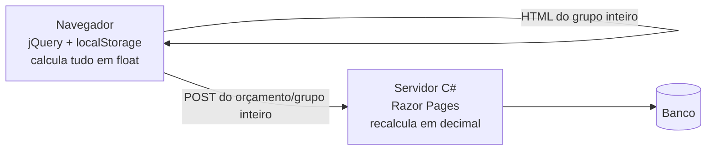
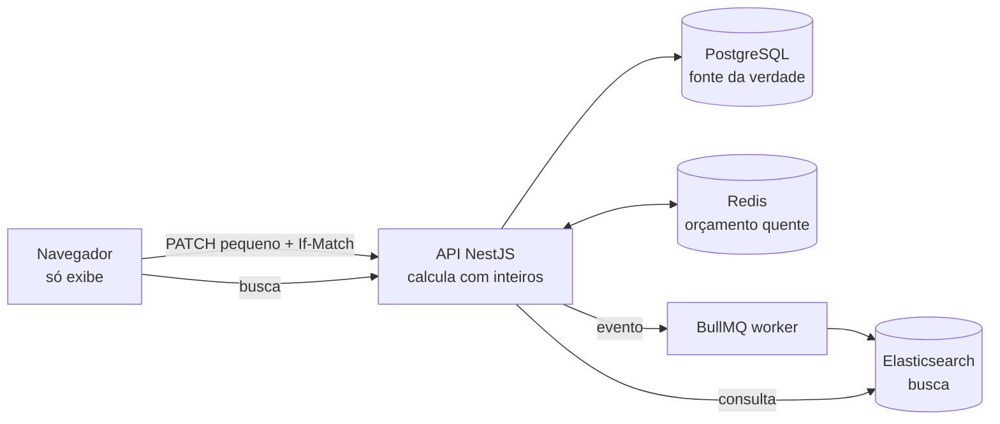

<!--
  ESQUELETO DO README
  - Trechos entre ⟨ ⟩ são para preencher.
  - "—" nas tabelas = número ainda não medido. Preencher só com medições reais (ver "Como medimos").
  - ⟨decidir: …⟩ marca decisões de projeto ainda em aberto.
-->

# Orçamentos v2 · reescrita de um sistema de orçamentos

> Um sistema de orçamentos em que trabalhei tinha problemas de **arquitetura e de lógica**: o *como* tinha sido decidido, não o *quê*. Este repositório reconstrói o problema de forma genérica e mostra **como eu resolveria cada um**, com medições lado a lado.

**Stack:** TypeScript · Node.js · NestJS · PostgreSQL + Prisma · Redis · Elasticsearch · BullMQ · React + Vite · Vitest · Docker · Sentry · Prometheus
**Versão legada (reprodução):** ASP.NET Core Razor Pages · jQuery · PostgreSQL + Entity Framework

[](https://github.com/PhrStyle/rework-budgets-system/actions/workflows/ci.yml)

---

## Sumário

- [Em 30 segundos](#em-30-segundos)
- [Contexto](#contexto)
- [Regras de negócio](#regras-de-negócio)
- [Problemas e soluções](#problemas-e-soluções)
- [Antiga × nova: números](#antiga--nova-números)
- [Arquitetura](#arquitetura)
- [Estudos de caso](#estudos-de-caso)
- [Como medimos](#como-medimos)
- [Stack e por quê](#stack-e-por-quê)
- [Como rodar](#como-rodar)
- [Estrutura do repositório](#estrutura-do-repositório)
- [Como este projeto foi feito](#como-este-projeto-foi-feito)
- [Status](#status)

---

## Em 30 segundos

- **Antes:** Razor Pages + jQuery + `localStorage`, com o orçamento inteiro recalculado no navegador, float no JS contra decimal no C#, e um sistema que era aceitável em dev e lento na VPS dos EUA.
- **Depois:** o servidor calcula com **inteiros**, por **delta**; o orçamento quente fica no **Redis**; a busca vai para o **Elasticsearch**; o front só exibe.
- **Resultado:** ⟨1 frase com o principal ganho medido, ex.: “abrir um grupo de 5 mil itens: X s → Y ms no ambiente emulado da VPS”⟩.

<!-- GIF curto: abrir orçamento grande na legada vs nova, lado a lado (docs/img/antes-depois.gif) -->
<!--  -->

---

## Contexto

| | |
|---|---|
| **Produto** | Sistema de orçamentos: listagem com filtros; orçamento com cabeçalho (cliente, vendedor, status, ajuste de prazo %, margem %), grupos personalizáveis e produtos com busca, quantidade, desconto por item e ordenação |
| **Escala** | Orçamentos com ⟨milhares⟩ de produtos; orçamentos podem conter outros orçamentos (1 nível) |
| **Stack original** | C# · Razor Pages · jQuery · JavaScript · `localStorage` · PostgreSQL + Entity Framework |
| **Infra original** | VPS Contabo, US Central; usuários no Brasil |
| **Meu papel** | Engenheiro de software, único desenvolvedor do sistema |

Assumi o sistema depois de **dois anos** de desenvolvimento por outra pessoa, já com várias decisões de arquitetura e de lógica que causavam os problemas abaixo. Este repositório é o registro de como eu os corrigiria.

> O sistema antigo é reproduzido aqui **de forma genérica**, com dados fictícios. Não é o código original.

---

## Regras de negócio

As duas versões implementam as mesmas regras; só muda **como**.

| Regra | Definição |
|---|---|
| Item | `preço por unidade × quantidade × (1 − desconto do item %)` |
| Unidades | Cada produto tem a sua: **un** (só inteiros), **m**, **L** e **kg** (até 2 casas decimais) |
| Desconto | **Só por item**, de 0% a 100%. Não há desconto no grupo nem no total |
| Ajuste de prazo | De −100% a +100% (pode ser negativo) |
| Margem | De 0% a +100% (reduções são feitas pelo desconto do item) |
| Grupo | Soma dos itens |
| Orçamento | `(Σ grupos + Σ totais dos filhos) → aplica o ajuste de prazo % → aplica a margem %`, nessa ordem, cada um sobre o resultado anterior |
| Orçamento filho | Um orçamento pode conter outros, **no máximo 1 nível**. O filho entra no pai pelo **próprio total**, já com o prazo e a margem dele; o pai aplica os seus por cima |
| Status | Rascunho, Enviado, Aprovado, Perdido. Apenas organizacional: não muda cálculo nem permissões |
| Edição | Um orçamento aberto por um usuário fica bloqueado para os demais usuários |
| Grupos | Servem para organizar e carregar sob demanda. Vários grupos podem ser abertos, vistos e editados **ao mesmo tempo** |
| Arredondamento | Comercial (meio centavo para cima), aplicado só onde há divisão (percentuais) |

---

## Problemas e soluções

| # | Problema (antes) | Impacto | Solução (agora) | Tecnologia | Resultado |
|---|---|---|---|---|---|
| 1 | Orçamento inteiro recalculado no navegador a cada alteração (jQuery) | Tela travando com milhares de itens | Cálculo no servidor, incremental por **delta** | NestJS · Redis | — |
| 2 | Lazy loading de grupos com cache em `localStorage` | Cache por navegador, com cota, sem invalidação | Orçamento quente no **Redis** (cache-aside) + itens paginados | Redis | — |
| 3 | Busca e filtro de orçamentos ⟨como era⟩ | ⟨lentidão / filtros limitados⟩ | Índice de busca atualizado por fila | Elasticsearch · BullMQ | — |
| 4 | Float no JS × decimal no C#; paliativo: arredondar sempre para cima em todo cálculo | Valor na tela ≠ valor gravado; totais enviesados para cima | Dinheiro em **inteiros** (centavos, pontos-base), uma só implementação, arredondamento padrão só nas divisões; o paliativo sai | `packages/money` · Vitest | — |
| 5 | Orçamento dentro de orçamento (1 nível) alterando o cálculo | ⟨total do pai defasado / regra espalhada⟩ | Servidor valida a profundidade e soma o total atual dos filhos | NestJS · Prisma | — |
| 6 | Aceitável em dev, lento na VPS dos EUA | Latência e CPU de produção invisíveis no dev | Projeto pensado para latência; benchmark em ambiente que emula a VPS | Docker · Toxiproxy · k6 | — |
| 7 | Tela complexa em jQuery (inserir acima/abaixo, reordenar) misturada ao cálculo | Difícil de manter e de evoluir | Front só exibe estado; reordenação por índice fracionário | ⟨front⟩ | — |
| 8 | Sem testes no front, justamente onde ficava o cálculo (a parte mais crítica) | Regressões em valores só apareciam em uso | Cálculo em funções puras de TypeScript, compartilhadas e cobertas por testes | `packages/money` · Vitest | — |
| 9 | Após cada deploy, o navegador usava o JS antigo em cache com o back-end novo; solução era Ctrl+F5 | Telas quebradas que pareciam bugs; perda de confiança no time | Arquivos com hash no nome, `index.html` sem cache, versão da API checada pelo front, contratos compartilhados | Vite · `packages/contracts` | — |
| 10 | Orçamento marcado como "aberto" no banco para bloquear outros usuários; o mesmo usuário em várias abas ficava com estados divergentes | Abas desatualizadas salvando por cima uma da outra | ⟨Bloqueio de edição com expiração no Redis⟩ + versão por grupo (409) + sincronização entre abas | Redis · `BroadcastChannel` · TanStack Query | — |
| 11 | Salvar enviava o orçamento **inteiro** (ex.: 12 grupos e 500+ produtos para mudar um) | Salvamentos lentos e transações enormes para mudanças pequenas | `PATCH` só do que mudou, transação pequena, envio em lote das edições | NestJS · Postgres · Redis | — |

### Por que trocar de stack?

O banco continua **PostgreSQL**; o Entity Framework dá lugar ao **Prisma**. A mudança principal é trocar **C# no back-end + JavaScript no front-end** por **TypeScript nos dois lados**:

- **Uma linguagem só.** A manutenção era mais difícil com duas linguagens fazendo partes da mesma regra; a divergência entre `float` (JS) e `decimal` (C#) nasceu disso.
- **Código compartilhado.** Tipos, contratos da API (DTOs e validação) e o cálculo de dinheiro ficam em pacotes usados pela API e pela tela.
- **Cálculo centralizado e testável.** Fora do DOM, a regra vira funções puras, fáceis de testar. No projeto antigo o front, a parte mais crítica, não tinha testes porque o cálculo estava preso à tela.

---

## Antiga × nova: números

Mesmas ações, mesmos dados, no ambiente que emula a produção (ver [Como medimos](#como-medimos)).

**Ambiente:** ⟨4 vCPU / 8 GB · RTT ~X ms · Y Mbps · N usuários virtuais⟩ · **Dados:** ⟨orçamento com 5.000 itens em 4 grupos⟩

| Cenário | Legada | Nova | Ganho |
|---|---|---|---|
| Abrir orçamento (cabeçalho + grupos) | — | — | — |
| Abrir grupo com 5.000 itens | — | — | — |
| Editar 1 quantidade: tela atualiza | — | — | — |
| Editar 1 quantidade: salvo no servidor | — | — | — |
| Alterar margem (%) | — | — | — |
| Reordenar 1 item | — | — | — |
| Buscar orçamentos (p95) | — | — | — |
| Payload por edição | — | — | — |
| CPU do servidor por salvamento | — | — | — |
| Throughput com N usuários (req/s) | — | — | — |
| Divergência de centavos (tela × banco) | — | R$ 0,00 | — |
| Edições concorrentes detectadas | — | — | — |

<!-- gráfico gerado do resultado do k6: docs/img/benchmark.png -->

**Demo visual:** [`prototype/index.html`](prototype/index.html) mostra as duas versões funcionando (abra no navegador). Os números do protótipo são parcialmente simulados; os desta tabela vêm do benchmark real.

---

## Arquitetura

### Antes



### Depois



⟨2–3 frases sobre o fluxo de uma edição e o fluxo de leitura⟩

---

## Estudos de caso

> Cada caso traz o problema, o impacto, a solução e o resultado medido, com trade-offs e onde ver no código.

### 1. Cálculo do orçamento no navegador

- **Problema:** ⟨O orçamento inteiro era recalculado em JavaScript a cada alteração. Com milhares de itens, …⟩
- **Impacto:** ⟨tela travada por X ms; regra de cálculo espalhada no front; …⟩
- **Solução:**
  - ⟨Cálculo no servidor; subtotal por grupo mantido por delta (novo − antigo)⟩
  - ⟨Total = soma dos subtotais dos grupos + totais dos filhos; alterar a margem não lê itens⟩
  - ⟨Totais atômicos no Redis (`HINCRBY`), Postgres como fonte da verdade⟩

- **Resultado:**

| Métrica | Antes | Depois |
|---|---|---|
| Itens lidos por edição | — | — |
| Tempo até a tela atualizar | — | — |

- **Trade-offs:** ⟨Toda edição paga o RTT até o servidor; resposta otimista possível porque o cálculo é inteiro e determinístico.⟩
- **Onde ver:** ⟨`apps/api/src/budgets/…`⟩ · ⟨teste: `…spec.ts`⟩

---

### 2. Lazy loading com `localStorage`

- **Problema:** ⟨Para não trazer milhares de produtos, abria-se só o cabeçalho e os títulos/valores dos grupos; ao abrir um grupo, ele ficava no `localStorage`.⟩
- **Impacto:** ⟨Cache por navegador, cota de ~5 MB, sem invalidação: dados desatualizados sem aviso.⟩
- **Solução:**
  - ⟨Orçamento quente no Redis: resumo + itens por grupo, cache-aside na leitura, invalidação na escrita, TTL⟩
  - ⟨Itens paginados por cursor⟩

- **Resultado:**

| Métrica | Antes | Depois |
|---|---|---|
| Abrir grupo de 5.000 itens | — | — |
| Hit ratio do cache | — | — |
| Armazenamento no navegador | — | 0 B |

- **Trade-offs:** ⟨Consistência Redis × Postgres: Postgres sempre ganha; job que recalcula do zero e mede drift.⟩
- **Onde ver:** ⟨…⟩

---

### 3. Busca e filtro de orçamentos

- **Problema:** ⟨como era a busca⟩
- **Impacto:** ⟨…⟩
- **Solução:**
  - ⟨Índice no Elasticsearch atualizado por evento (BullMQ)⟩
  - ⟨Autocomplete de produtos (edge n-gram + fuzzy)⟩

- **Resultado:**

| Métrica | Antes | Depois |
|---|---|---|
| Busca p95 | — | — |
| Autocomplete p95 | — | — |

- **Trade-offs:** ⟨Consistência eventual: a listagem pode atrasar alguns segundos; lag exposto como métrica.⟩
- **Onde ver:** ⟨…⟩

---

### 4. Dinheiro: float × decimal

- **Problema:** O navegador calculava em float (JavaScript) e o servidor em decimal (C#), e os valores divergiam em centavos. Como **paliativo**, com o aval do cliente, passou-se a **arredondar sempre para cima em todo cálculo**: se fosse para errar, que errasse para cima e minimizasse as perdas.
- **Impacto:** O valor visto pelo usuário não era o gravado; havia duas implementações da mesma regra. O paliativo só escondia o problema: em float até o arredondamento para cima falha (`1.1 * 100 = 110.00000000000001` → 111 centavos), e os totais ficavam enviesados para cima. Os problemas de cálculo chegaram a cortar funcionalidade: uma versão anterior tinha **desconto no total e por item**, e o desconto no total foi removido, ficando só o por item.
- **Solução:**
  - Valores em **centavos inteiros** (×100) e percentuais em **pontos-base inteiros** (5,5% = 550); colunas `Int`/`BigInt`, nunca `Float`
  - Soma, subtração e preço × quantidade são exatas. Só há arredondamento onde há **divisão** (aplicar desconto, prazo e margem), com **uma regra padrão**, o **arredondamento comercial** (meio centavo para cima), o mesmo que o cliente já usa ao conferir à mão, igual no front e no back
  - O **arredondamento sempre para cima sai**: sem divergência entre duas implementações, não há perda a compensar
  - Divisão por 100 **só na exibição**, por quociente e resto; entrada convertida por texto, sem `parseFloat`
  - Pacote `packages/money` usado pela API (e pelo front, se houver resposta otimista)

```ts
// packages/money: item = preço × qtd × (100% − desconto), uma única divisão no fim
export function itemTotal(price: Cents, quantity: Qty, discount: Bp): Cents {
  return cents(mulDivRoundHalfUp([price, quantity, BP_SCALE - discount], QTY_SCALE * BP_SCALE));
}

itemTotal(cents(123456), qty(300), bp(750)); // R$ 1.234,56 × 3 un com 7,5% → 342590 (R$ 3.425,90)
```

- **Resultado:**

| Métrica | Antes | Depois |
|---|---|---|
| Divergência tela × banco (orçamento de 5.000 itens) | — | R$ 0,00 |
| Valor cobrado a mais pelo arredondamento para cima | — | R$ 0,00 (paliativo removido) |
| Implementações da regra de cálculo | 2 | 1 |
| Testes do pacote de dinheiro | 0 | 38 (com testes de propriedade contra `BigInt`), 100% das linhas |

- **Trade-offs:** ⟨Trocar o “sempre para cima” por uma regra padrão muda os totais em alguns centavos em relação ao sistema antigo; a mudança precisa ser comunicada ao cliente, que tinha aprovado o paliativo.⟩
- **Onde ver:** [`packages/money`](packages/money/src) · [ADR 0001](docs/adr/0001-dinheiro-em-inteiros.md) · [ADR 0002](docs/adr/0002-pacote-proprio-de-dinheiro.md)

---

### 5. Orçamento dentro de orçamento (1 nível)

- **Problema:** ⟨Um orçamento podia conter outros, com profundidade máxima de 1; o total dos filhos entrava no cálculo do pai.⟩
- **Impacto:** ⟨…⟩
- **Solução:**
  - ⟨`Budget.parentId`; validação no servidor (422): filho não tem filhos, quem tem filhos não vira filho⟩
  - ⟨Total do pai = (subtotais + total atual de cada filho) × prazo × margem⟩
  - ⟨Editar um filho invalida o cache do pai⟩

- **Resultado:** ⟨…⟩
- **Onde ver:** ⟨…⟩

---

### 6. Rápido em dev, lento em produção

- **Problema:** ⟨Em desenvolvimento a velocidade era aceitável; na VPS Contabo em US Central, com usuários no Brasil, ficava muito lento.⟩
- **Impacto:** ⟨…⟩
- **Solução:**
  - ⟨Ambiente de benchmark que emula a VPS: CPU/memória limitadas + latência e banda injetadas⟩
  - ⟨Menos idas e voltas, payloads pequenos, trabalho pesado em fila⟩

- **Resultado:** ⟨tabela da seção “Antiga × nova” nos dois ambientes⟩
- **Onde ver:** ⟨`bench/`⟩

---

### 7. Tela complexa acoplada ao cálculo

- **Problema:** ⟨Inserir produto acima/abaixo de uma linha, reordenar, editar quantidade e desconto, tudo em jQuery manipulando o DOM e recalculando. Na época, eu já defendia uma SPA (ex.: React): cálculos, status e taxas precisavam ser dinâmicos, e o modelo de páginas com jQuery não acompanhava isso.⟩
- **Impacto:** ⟨…⟩
- **Solução:**
  - ⟨Front só exibe o estado devolvido pela API⟩
  - ⟨Posição por índice fracionário: mover um item altera uma linha⟩

- **Resultado:** ⟨…⟩
- **Onde ver:** ⟨…⟩

---

### 8. Sem testes na parte mais crítica

- **Problema:** ⟨O cálculo vivia no front, em JavaScript que lia e escrevia o DOM. Não havia testes no front.⟩
- **Impacto:** ⟨Erros de valor só apareciam em uso; mudar a regra era arriscado.⟩
- **Solução:**
  - ⟨Regra em funções puras de TypeScript (`packages/money`, `packages/budget-calc`), sem DOM nem banco⟩
  - ⟨Testes unitários e de propriedade (ex.: delta acumulado == recálculo do zero)⟩
  - ⟨Testes de componentes no front com Vitest + Testing Library⟩

- **Resultado:**

| Métrica | Antes | Depois |
|---|---|---|
| Testes da regra de cálculo | 0 | — |
| Cobertura de `packages/*` | — | — |

- **Onde ver:** ⟨…⟩

---

### 9. Front antigo em cache após o deploy

- **Problema:** A cada atualização, o JS e o C# eram publicados juntos no servidor, mas o navegador dos usuários mantinha o JS da versão anterior em cache. O sistema abria com o **front antigo falando com o back-end novo**. A saída era pedir para limpar o cache ou recarregar com Ctrl+F5.
- **Impacto:** Várias partes quebravam logo depois de cada deploy, parecendo bugs da nova versão. O problema era recorrente e afetava a reputação e a confiança no time de desenvolvimento.
- **Solução:**
  - ⟨**Cache busting:** o Vite gera arquivos com hash do conteúdo no nome (`app.3f9a1c.js`). Versão nova = nome novo = o navegador é obrigado a baixar⟩
  - ⟨**Cache por tipo de arquivo:** `index.html` com `Cache-Control: no-cache` (sempre revalida); assets com hash como `immutable` e cache longo⟩
  - ⟨**Versão em toda resposta:** a API devolve `X-App-Version`; se for diferente da versão do front, a tela mostra “Nova versão disponível, recarregar”, sem quebrar⟩
  - ⟨**Contratos compartilhados:** os tipos da API ficam em `packages/contracts`; uma mudança incompatível quebra o build, não o usuário⟩
  - ⟨**Deploy compatível:** a API aceita a versão anterior do front durante a transição (mudanças aditivas primeiro, remoções depois)⟩

- **Resultado:**

| Métrica | Antes | Depois |
|---|---|---|
| Ctrl+F5 necessário após deploy | sim, recorrente | — |
| Erros no Sentry nas primeiras horas após deploy | — | — |
| Tempo até todos os usuários estarem na versão nova | — | — |

- **Trade-offs:** ⟨Uma SPA separa front e back em dois artefatos, o que **aumenta** o risco de descompasso de versões se nada for feito. A mitigação acima precisa existir desde o primeiro deploy.⟩
- **Onde ver:** ⟨configuração do Vite, middleware de versão na API, teste de compatibilidade⟩

---

### 10. Edição concorrente e várias abas

- **Problema:** Para evitar que dois usuários editassem o mesmo orçamento, ele era marcado como **aberto** no banco ao ser aberto, e os outros usuários eram impedidos de abri-lo. Isso não cobria o próprio usuário: abrindo o mesmo orçamento em **várias abas**, como o estado dependia do `localStorage` e de alterações na página, cada aba tinha a sua versão e só uma ficava salva.
- **Impacto:** Abas desatualizadas e descompassadas; alterações de uma aba se perdiam ou sobrescreviam as de outra.
- **Solução:**
  - ⟨**Bloqueio do orçamento com expiração** no Redis (`SET NX` + TTL renovado por *heartbeat*), no lugar da marcação no banco. A regra continua a mesma (um usuário por orçamento), mas se o navegador fechar, o bloqueio expira sozinho; a tela mostra “em edição por ⟨usuário⟩”⟩
  - ⟨**Versão por grupo:** cada `PATCH` envia `If-Match`; uma aba com versão velha daquele grupo recebe 409 e recarrega só o grupo. Como a versão é por grupo, editar grupos diferentes ao mesmo tempo (inclusive em abas diferentes) não gera conflito falso⟩
  - ⟨**Abas sincronizadas:** após salvar, a aba avisa as outras via `BroadcastChannel`, que invalidam o cache do TanStack Query; ao ganhar foco, a aba revalida⟩

- **Resultado:**

| Métrica | Antes | Depois |
|---|---|---|
| Edições perdidas entre abas (teste automatizado) | — | 0 |
| Bloqueios “presos” após fechar o navegador | — | 0 (expiram em ⟨N⟩ s) |
| Conflitos detectados e recarregados | — | — |

- **Trade-offs:** ⟨O bloqueio por orçamento impede dois usuários de trabalharem em paralelo no mesmo orçamento; foi mantido porque é a regra de negócio conhecida pelos usuários. A expiração troca “bloqueio preso para sempre” por “até ⟨N⟩ s após fechar a tela”.⟩
- **Onde ver:** ⟨…⟩

---

### 11. Salvar o orçamento inteiro para mudar um item

- **Problema:** Para salvar, o front enviava ao back-end o orçamento **inteiro**: todos os grupos e todos os produtos. Num orçamento com 12 grupos e mais de 500 produtos, alterar um único item significava trafegar e gravar os 12 grupos e os 500+ produtos.
- **Impacto:** Salvamentos extremamente lentos mesmo para mudanças pequenas, transações grandes no banco e payloads pesados cruzando a rede até a VPS.
- **Solução:**
  - ⟨`PATCH` só do campo alterado (`/items/:id`), com transação pequena: 1 item + o subtotal do grupo (delta)⟩
  - ⟨Redis atualizado na mesma operação (*write-through*), sem varrer o orçamento⟩
  - ⟨Edições feitas em sequência são agrupadas no front e enviadas em lote (`PATCH /groups/:gid/items`), economizando idas e voltas com RTT alto⟩
  - ⟨Experimento opcional e medido: gravar no Redis e persistir no Postgres por fila (*write-behind*)⟩

- **Resultado:**

| Métrica | Antes | Depois |
|---|---|---|
| Linhas gravadas para alterar 1 item (12 grupos, 500+ produtos) | 500+ | — |
| Payload por salvamento | — | — |
| Tempo de salvamento | — | — |

- **Trade-offs:** ⟨*Write-behind* reduz a latência de escrita, mas um item pode ser perdido se o Redis cair antes de persistir (mitigado com AOF e confirmação da fila). Por isso a base é *write-through*.⟩
- **Onde ver:** ⟨…⟩

---

## Como medimos

| | |
|---|---|
| **Ambiente “VPS”** | ⟨Docker com `--cpus=4 --memory=8g`; latência e banda injetadas entre o cliente e a API⟩ |
| **Calibração** | ⟨RTT medido de verdade do Brasil até uma VPS em US Central: X ms; CPU calibrada com benchmark⟩ |
| **Carga** | ⟨k6, N usuários virtuais, cenários em `bench/`⟩ |
| **Dados** | ⟨seed: N orçamentos, grupo grande com 5.000 itens⟩ |
| **Legada** | Versão simplificada em ASP.NET Core Razor Pages + jQuery (`legacy/`), na stack original, reproduzindo os 11 problemas, contra o mesmo Postgres e os mesmos dados |
| **O que não está aqui** | ⟨limitações conhecidas da medição⟩ |

Reproduzir:

```bash
⟨docker compose -f compose.yml -f compose.vps.yml up -d && pnpm bench⟩
```

---

## Stack e por quê

| Tecnologia | Papel | Por quê |
|---|---|---|
| TypeScript + Node.js | API, workers, front | Uma linguagem nos dois lados; tipos, contratos e cálculo compartilhados |
| React + Vite | Tela | ⟨…⟩ |
| TanStack Query | Estado vindo do servidor no front | ⟨…⟩ |
| NestJS | API REST | ⟨…⟩ |
| PostgreSQL + Prisma | Fonte da verdade | ⟨…⟩ |
| Redis | Orçamento quente, totais atômicos, filas (BullMQ) | ⟨…⟩ |
| Elasticsearch | Listagem, filtros e autocomplete | ⟨…⟩ |
| Vitest | Testes unitários e de integração | ⟨…⟩ |
| Docker Compose | Ambiente local e ambiente “VPS” | ⟨…⟩ |
| Toxiproxy · k6 | Emular rede de produção e medir | ⟨…⟩ |
| Sentry · Prometheus · pino | Erros, métricas e logs estruturados com ID de requisição | ⟨…⟩ |
| ASP.NET Core Razor Pages · jQuery | Versão legada (reprodução) | Medir o “antes” na stack original, não numa imitação |

---

## Como rodar

```bash
⟨git clone …⟩
⟨docker compose up -d⟩
⟨pnpm install && pnpm db:seed && pnpm dev⟩
⟨pnpm test⟩
```

---

## Estrutura do repositório

```
apps/api            API NestJS
apps/web            front React + Vite
packages/money      dinheiro em inteiros
packages/contracts  contratos da API compartilhados
legacy/             versão legada em ASP.NET Core Razor Pages + jQuery
bench/              k6 + perfis de rede (Toxiproxy)
prototype/          protótipo visual (HTML único)
docs/adr/           decisões de arquitetura
```

---

## Como este projeto foi feito

**Processo.** Todo o trabalho entra por pull request, com descrição e checklist, e passa pela CI (lint, tipos e testes) antes de ir para a `main`. Cada decisão relevante tem um ADR curto em [`docs/adr/`](docs/adr/).

**Uso de IA.** Usei IA (Claude Code) como ferramenta ao longo do projeto, com as decisões sob minha responsabilidade:
- **Orquestrei** o trabalho: defini o problema a partir da minha experiência no sistema original, o escopo, o que conta como pronto e a ordem das etapas.
- **Estudei as decisões** antes de adotá-las: dinheiro em inteiros (centavos e pontos-base) no lugar de float e decimal; arredondamento comercial no lugar do “sempre para cima” do sistema antigo; bloqueio de edição com expiração no lugar da marcação no banco; cálculo por delta no servidor.
- **Comparei trade-offs** entre alternativas: *write-through* × *write-behind*; React + Vite × Next.js × HTMX; reproduzir a versão legada em ASP.NET Core × em Node; cache do TanStack Query × `localStorage`.
- **Pesquisei soluções alternativas**: biblioteca pronta de dinheiro (Dinero.js) × pacote próprio; emular a VPS localmente (Toxiproxy, `tc netem`) × medir numa VPS real; bloqueio exclusivo por orçamento × edição simultânea com conflitos por grupo.
- **Validei os métodos**: conferi o protótipo contra o comportamento real do sistema antigo e corrigi suposições erradas (onde ficava o arredondamento para cima, como funcionava o bloqueio de edição, o salvamento do orçamento inteiro); separei o que é medido do que é simulado; ⟨testes automatizados, benchmark e revisão do código, a completar ao longo do projeto⟩.

---

## Status

**Pronto =** as duas versões funcionando, com os 11 problemas reproduzidos na legada e resolvidos na nova, medidos e documentados.

- [x] Protótipo visual (`prototype/index.html`)
- [x] Repositório, CI e convenções
- [x] `packages/money` + testes
- [ ] Infra local (Docker Compose: Postgres, Redis, Elasticsearch)
- [ ] Versão legada (ASP.NET Core Razor Pages + jQuery)
- [ ] API nova: Postgres → Redis → Elasticsearch
- [ ] Front (React + Vite + TanStack Query)
- [ ] Ambiente “VPS” e benchmark
- [ ] README preenchido com os números
